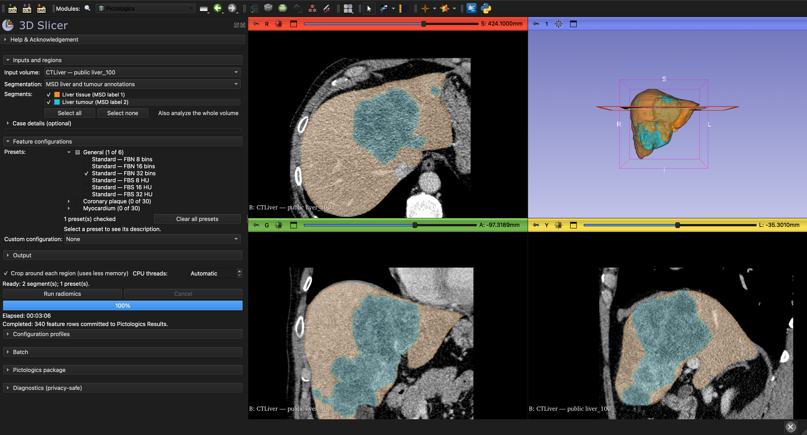
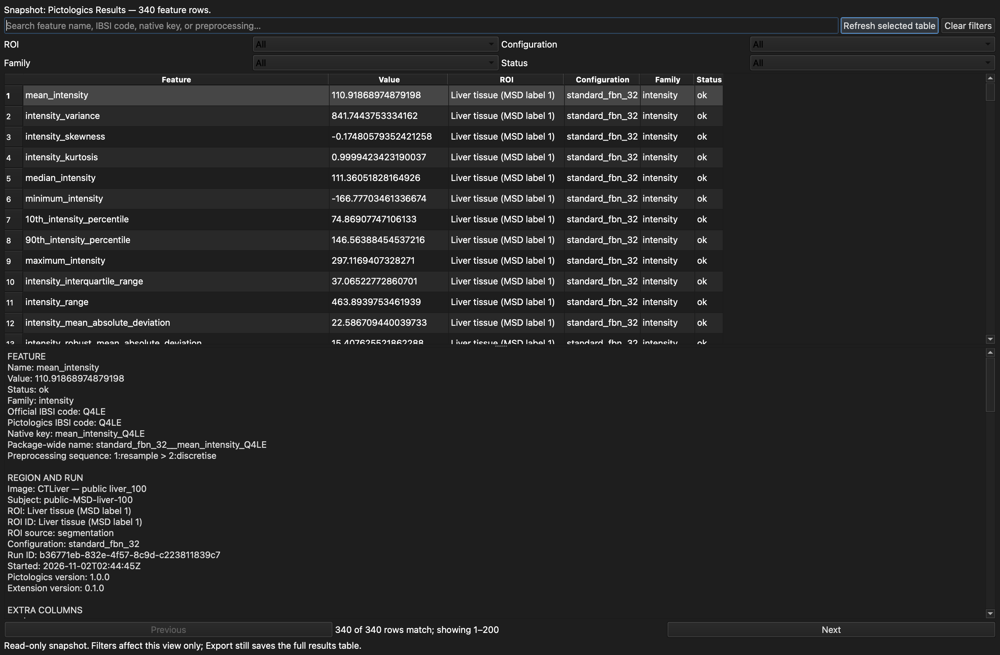

# Pictologics for 3D Slicer

[](https://github.com/martonkolossvary/SlicerPictologics/actions/workflows/ci.yml)
[](https://codecov.io/gh/martonkolossvary/SlicerPictologics)

Extract image-intensity, shape and texture features from 3D images and segmented
regions in [3D Slicer](https://www.slicer.org/), powered by
[Pictologics](https://github.com/martonkolossvary/pictologics).

Research software only—not for clinical diagnosis or treatment decisions.



*Public CTLiver example: liver tissue (orange) and tumour (cyan), with 170 features
per ROI and 340 successful rows using Pictologics 1.0.0. These are supplied research
annotations, not clinical validation by this project.
[Data attribution and reproduction](docs/screenshots/README.md).*

## Features

- Analyze multiple segments or batches of cases in a cancellable background worker.
- Select individual presets: **General (6)**, **Coronary plaque (30)** and **Myocardium (30)**.
- Build configurations in the panel: resampling, mask growth and rings, normalisation,
  intensity range, outlier filter, largest part, all IBSI 2 filters as a filter bank,
  and discretisation. Or load custom YAML/JSON, and save reusable profiles.
- Browse and filter results with native feature identifiers and preprocessing provenance.
- Export full-precision CSV or JSON; retain results and batch reports in saved scenes.
- Install tested dependencies privately, without replacing Slicer's shared packages.

## Modules

- **Pictologics** (Informatics): select an image, segments and settings, run the
  extraction, then browse and export the results.
- **Pictologics Worker (internal)**: the background process that runs Pictologics
  for the Pictologics module. Do not open it directly.

## Install

Requires **3D Slicer 5.12** or later on Linux, Windows or macOS.

1. In Slicer, open **View → Extensions Manager**.
2. Search for **Pictologics**, select **Install**, then restart Slicer.
3. Open **Informatics → Pictologics**. On first use, approve the installation of
   Pictologics into a private folder. This needs internet access.

The extension installs one tested Pictologics release, named in
[requirements-pictologics.txt](PictologicsSlicer/requirements-pictologics.txt).
New releases are adopted only after compatibility checks pass. After you update
the extension, select **Install / update adopted release…**. To run the newest
source code, [load a development checkout](docs/development.md#load-a-development-checkout).

The private folder needs about 600 MB. The install dialog shows where it is (on
macOS, `~/Library/Application Support/slicer.org/Slicer/SlicerPictologics`). To free
the space, select **Remove private packages…** in the **Pictologics package** section
before you uninstall the extension, or delete that `SlicerPictologics` folder later.

## Quick start

1. Load a 3D scalar image and a segmentation. To try the module, load **CTLiver**
   from the **Sample Data** module and draw a segment in **Segment Editor**.
2. Open **Informatics → Pictologics**, select the image, and check the segments.
3. Check presets in the preset tree, or add a custom configuration.
   **Clear all presets** clears every group.
4. Check the readiness message, choose an output table, and select **Run radiomics**.
5. Open **Browse results and provenance…**, then **Export table as CSV or JSON…**.
   Wide CSV uses Pictologics' native feature names; CSV also writes provenance and
   feature-catalog sidecars.



*Results from the same liver CT run, showing feature values, IBSI identifiers,
preprocessing details and software versions.*

## Important limits

- One scalar 3D image per run; no vector/4D inputs or DICOM-folder batch loading.
- Nonlinear transforms are not supported; linear transforms are hardened temporarily.
- Fine resampling can require several GB of RAM. Cropping helps only where supported.
- Progress is ROI-level, not a time-remaining estimate; single-ROI runs use a busy indicator.
- Keep independent CSV/JSON exports, even when saving a scene.

See the [full user guide and limitations](docs/user-guide.md) for configuration,
filters, ROI refinement, batch processing, scripting and recovery details.

## Documentation

- [User guide](docs/user-guide.md)
- [Public sample data and image attribution](docs/screenshots/README.md)
- [Measured workloads and memory guidance](docs/performance.md)
- [Privacy-safe diagnostics and recovery](docs/diagnostics-and-recovery.md)
- [Developer guide and testing](docs/development.md)
- [Validation and release readiness](docs/release-readiness.md)

## How to cite

Cite Pictologics with the release that the exported provenance names, as in the
[Pictologics citation](https://github.com/martonkolossvary/pictologics#citation):

```text
Kolossváry M. Pictologics: IBSI-compliant radiomic feature extraction (version X.Y.Z). https://github.com/martonkolossvary/pictologics
```

## License

[Apache License 2.0](LICENSE); see [NOTICE](NOTICE). The public liver dataset and
annotations have separate [attribution and CC BY-SA 4.0 reuse terms](docs/screenshots/README.md).
